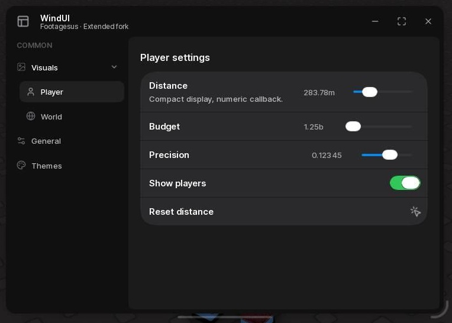
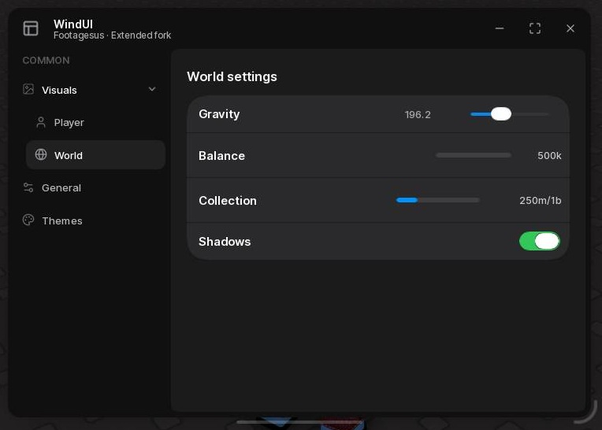
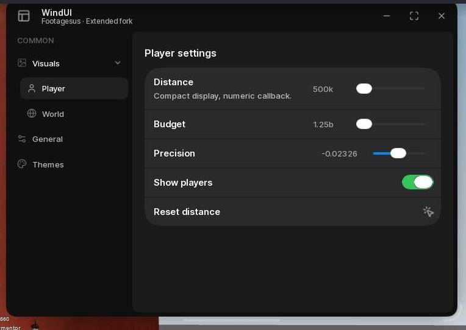
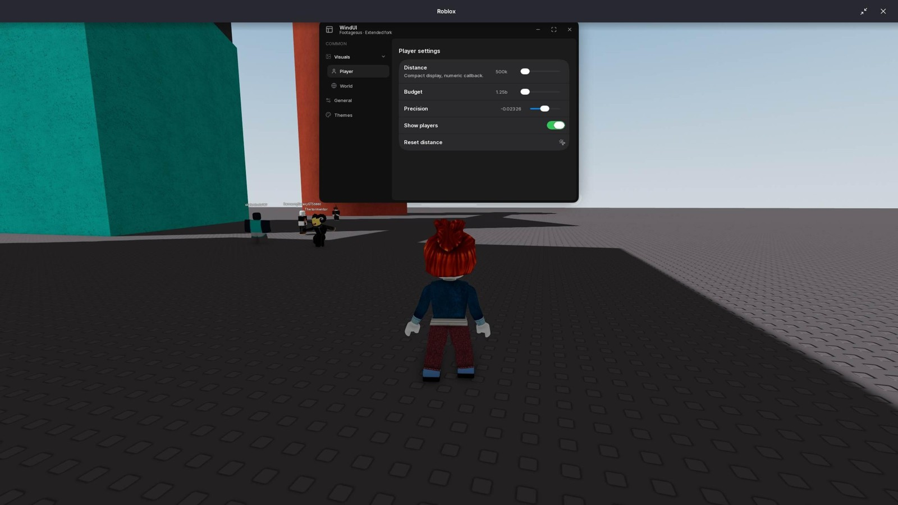
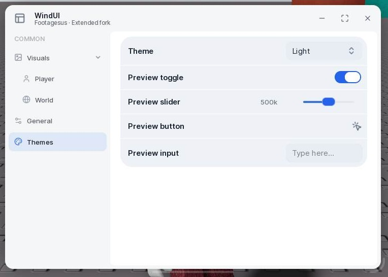
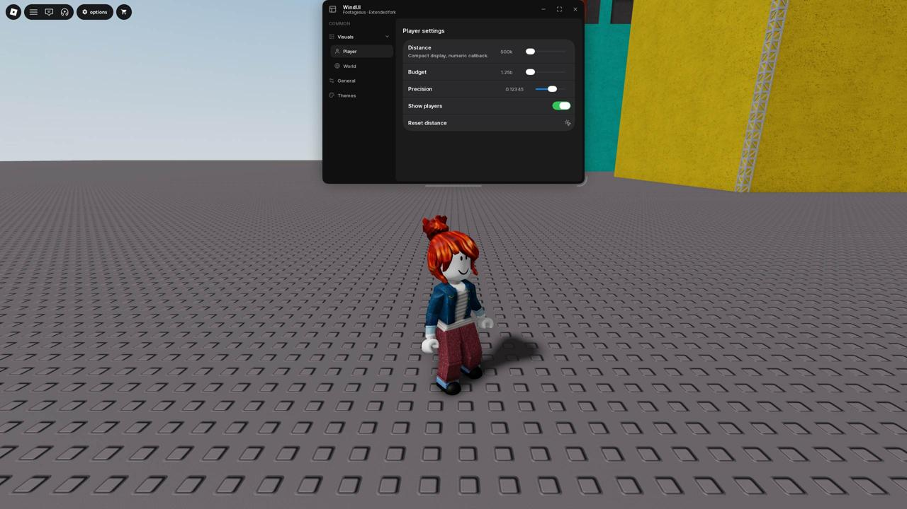
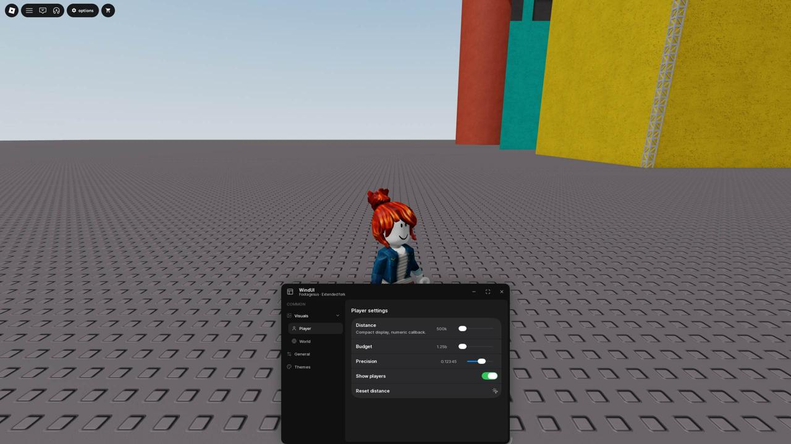

# WindUI Extended

Fork of [WindUI by Footagesus](https://github.com/Footagesus/WindUI), based on upstream 1.6.66 (`d2c9bac5f96f997418d680d19cb759892542e492`). Original MIT license and copyright retained. Not an official Footagesus release.

## Scope

The original WindUI element layout, slider position, buttons, window sizing, sidebar sections and horizontal containers are retained. No layout based on the second reference image is applied. Changes are limited to compact numeric displays, nested tabs, numerical/interaction fixes needed by those features, curated themes, optional offscreen locking, animated subtab/section expansion, optional profile preferences and theme-aware notification icons.

## Run

```lua
loadstring(game:HttpGet("https://raw.githubusercontent.com/123ads213/WindUI/main/ForkExample.lua"))()
```

Library only:

```lua
local WindUI = loadstring(game:HttpGet("https://raw.githubusercontent.com/123ads213/WindUI/main/dist/main.lua"))()
```

`ForkExample.lua` demonstrates actual nested pages and ordinary upstream-positioned elements, not a custom dashboard. Re-running it destroys the previous demo before loading a fresh library. The example pins its tested distribution commit so Roblox HttpGet caching cannot mix a new example with an old library. Upstream launchers are retained as upstream examples; use `ForkExample.lua` for this fork's features.

## Actual subtabs

```lua
local Visuals = Window:Tab({ Title = "Visuals", Icon = "image" })
local Player = Visuals:Tab({ Title = "Player", Icon = "user" })
local World = Visuals:Tab({ Title = "World", Icon = "globe" })

Player:Slider({
    Title = "Distance",
    Value = { Min = 0, Max = 1000000, Default = 500000 },
    Callback = function(number) print(number) end,
})
World:Toggle({ Title = "Shadows", Value = true, Callback = function(value) end })
```

- Click **Visuals**: its child buttons expand and the first unlocked child (**Player**) opens.
- Click **World**: World gets its own separate content page.
- Click Visuals again to collapse; reopening restores its last selected child.
- `Visuals:SubTab({...})` is an alias for `Visuals:Tab({...})`.
- `:Select()` / `Window:SelectTab(index)` resolve parent tabs to the last/first unlocked child. Selecting a child directly opens its ancestors.
- `:Expand()` / `:Collapse()` control the child list without changing content. Height and chevron rotation animate over 0.24 seconds; rapid reversals cancel the previous transition.
- Ordinary tabs and `Window:Section` keep their upstream behavior. Child tabs can also have children; locked branches are skipped.

## Lock Offscreen

```lua
local Window = WindUI:CreateWindow({
    Title = "My window",
    Size = UDim2.fromOffset(740, 520),
    LockOffscreen = true,
})
Window:SetLockOffscreen(false) -- runtime toggle
Window:SetLockOffscreen(true)  -- also brings an offscreen window back
Window:SetPosition(UDim2.fromScale(.5, .5))
```

Opt-in (default false) to preserve upstream behavior. The example enables it and includes a **General → Lock Offscreen** toggle. Dragging stops at the Roblox viewport edges, using the actual rendered window size and UIScale. Resizing and viewport changes re-clamp the position as well. This constrains the WindUI window, not the operating-system Roblox window. A manually configured window larger than the viewport must be resized/scaled to fit; locking its position does not override your chosen size.

## Compact numeric displays

Sliders (including their floating tooltips) and ProgressBar Value/Fraction modes show `500k`, `1.25m`, `1b`, `1t`, `qa`, `qi`, `sx`, `sp`, `oc`, `no`, `dc`. Values from 1e36 use scientific notation.

- Display formatting only: callbacks, `:Get()` and stored values remain numbers.
- `Compact = false` opts out; `Decimals = 2` controls abbreviated text, not numeric step precision.
- Focus the number to edit its full value. Plain values, `500k`, `1.25m` and scientific notation are accepted; invalid text restores the previous value.
- `Format = function(number) return ... end` overrides slider text and tooltip. ProgressBar keeps its existing Format signature.
- `WindUI.NumberFormat.Format(number, options)` is available for custom counters. User-authored text is not automatically converted.
- Sliders retain upstream inline positioning and `Width` (compact default 184; Compact=false keeps 130). The fixed `ValueWidth` (compact default 72; otherwise 48) prevents text changes from moving the track. Use a larger Width/ValueWidth for long custom formats or full precision readouts.
- Drag geometry is stable while digits/suffixes change; drag updates are not repeatedly tweened. Connections and scroll lock are cleaned on release, lock and destruction.
- Added `:Get()` and `:SetRange(min,max)`. Non-finite values are ignored; reversed/equal bounds are handled. Fractional callbacks are not truncated to two decimals.
- Roblox doubles cannot represent every integer above 2^53.

## Themes

Dark's palette is unchanged. Light is tuned, with five alternatives: Ocean, Forest, Ember, Orchid and Paper. Old near-duplicate upstream theme names were deliberately removed; update saved configurations referencing them. Custom themes via `AddTheme` still work.

## Build / tests

```sh
git clone --recurse-submodules https://github.com/123ads213/WindUI.git
cd WindUI
# Install Luau CLI and Darklua.
npm test
npm run build
```

- `tests/NumberFormat.luau`: standalone numeric formatting/parsing/bounds tests.
- `tests/TabTree.luau`: standalone nested selection routing tests.
- `tests/ForkRuntime.lua`: run after ForkExample inside Roblox; tests parent/child clicks, content-page isolation, selection memory, numeric input/dragging and upstream window limits. These are synthetic GUI-signal tests, not a physical input/device matrix.

See [current QA status](docs/fork/QA.md). The screenshots below are actual captures from revision 2, not the rejected dashboard layout.






## Requested spacing adjustments

The example sets `ContentPaddingTop = 10` in CreateWindow (upstream default remains 20 for a panel background), and `HeaderSize = 28` for COMMON (section default remains 42). You can use these explicit settings in your own windows without changing other upstream spacing. The compact slider reserves a fixed 72-pixel value slot plus 12-pixel gap and a 100-pixel track by default; its geometry never changes with the current value.

## Revision 3 regressions

- Decimal snapping is normalized to the precision implied by Min and Step, before display/callbacks. Negative minima no longer expose binary tails such as `-0.0232599999999999` for step `0.00001`.
- The example registers its window as soon as it is created, keeps a pending-library handle if setup fails, and gives reruns a generation ID. A newer invocation wins instead of leaving overlapping demos.
- Old stranded example roots are removed only when marked as this example or identified by the exact `Footagesus · Extended fork` author label. Unrelated WindUI windows are not blanket-deleted.
- `tests/ForkRerun.lua`: set `getgenv().__WindUIForkBuild` to dist/main.lua source and `getgenv().__WindUIForkExampleSource` to ForkExample.lua source, then run it. This is an intentionally destructive **demo-only** QA test: three reruns, a deliberate setup failure/recovery, and two concurrent starts. Results are stored in `__WindUIForkReruns`.





## Revision 4 — real viewport bounds and clean light contours

- LockOffscreen uses both `ScreenGui.AbsolutePosition` and `AbsoluteSize`, not an assumed (0,0) origin. Roblox can report a negative GUI origin (observed Y=-58); top and bottom now use the same rectangle. GUI origin/inset changes trigger re-clamping.
- The native OS/Roblox title bar is not drawn by WindUI and cannot be covered by a ScreenGui. The lock concerns the actual game viewport.
- Light and Paper use `CleanShapes = true`: native UICorner per-corner radii and uniform inner UIStroke instead of baked fill/glass sprites. Joined first/middle/last row geometry stays intact. No extra GuiObjects are inserted into UIListLayout.
- Dark and the other dark palettes keep their existing shape sprites. All themes use a clean native resting toggle thumb; the oversized glass rim is hidden, while the drag-only glass animation is retained.
- Legacy clients without per-corner UICorner properties fall back to the original texture for joined half-corner shapes.
- `tests/ForkVisual.lua` checks theme round trips, original row sizes/layout-child counts, per-corner grouping, theme-color propagation, resting toggles, and real top/bottom bounds.







## Tab selection animation

`Window:SelectTab(tab.Index)` and `tab:Select()` use the original WindUI page-slide animation (not a new layout). The duration/easing now match nested expansion: **0.24 seconds, Quad Out**. Repeated selection of the current page does not restart it; rapid switches cancel the previous tween. Click sidebar tabs directly to see page switching. For the separate collapsible Tab Section, use **APPEARANCE** (see below).

## Slider title icon

```lua
Player:Slider({
    Title = "Distance",
    Icon = "ruler", -- or Image = "ruler" (Image takes precedence)
    IconSize = 24, -- or ImageSize = 24
    Value = { Min = 0, Max = 1e9, Default = 500000 },
    Callback = function(value) print(value) end,
})
```

The icon occupies the existing WindUI element-image slot before the title/description; text reserves its width. It is separate from `Icons = { From = ..., To = ... }`, which places endpoint icons by the slider track. Omitting `Icon`/`Image` preserves the existing title layout. This title-icon configuration is supported on Slider; do not assume every other element forwards it.

## Window sizing and revision 5 contours

Window default size, min/max limits, auto-scaling, resize handles and fullscreen sizing code remain upstream behavior. The example still requests 740×520; minimum 560×350 and maximum 850×560 are unchanged. No new auto-size or scale rule was added for theme/animation fixes. LockOffscreen only clamps position to the GUI rectangle.

Ocean, Forest, Ember and Orchid now use the same clean native contour renderer as Light/Paper. Their palettes are unchanged. Dark retains its upstream panel rendering.

## Actual tab sections (revision 6 correction)

A **Tab Section** is the upstream collapsible sidebar group, not the temporary “Tab selection” dropdown from revision 5. The example now puts Themes inside **APPEARANCE**, created with:

```lua
local Appearance = Window:Section({ Title = "APPEARANCE", Opened = true })
local Themes = Appearance:Tab({ Title = "Themes", Icon = "palette" })
Appearance:Close()
Appearance:Open()
```

Click the APPEARANCE header to see its height and chevron animate together: 0.24s, Quad Out, cancellation on rapid reversal. Selecting Themes programmatically also opens its section. Visuals → Player/World remain nested tabs, not this section.

### Title icon alignment

Slider title icons default to **24px**, centred vertically on the full title/description block rather than its upper edge. A title without a description centres the icon on that title alone. `IconSize`/`ImageSize` overrides remain available. The example uses `Icon = "ruler", IconSize = 24`. The normal WindUI title/description spacing and fixed-width right-hand slider remain unchanged.

## Profile footer and preferences

Opt-in, not an alteration to every window:

```lua
local Profile = Window:CreateProfile({
    -- Name / Avatar optional; defaults to local Roblox display name and headshot.
    DaysRemaining = 30,
    Mock = true, -- data is a demo; no mock badge is shown in the UI
    StoreLink = "https://discord.gg/eqAEszZzHj",
    Themes = { "Dark", "Light", "Ocean", "Forest", "Ember", "Orchid", "Paper" },
    History = {
        { Version = "1.0.0", Date = "2026-10-18", Title = "Release",
          Description = "Your update description." },
    },
})
```

- Bottom-left card reserves its own space below the scrolling sidebar. Hover highlights the card and opens a rounded, theme-aware popover. A short leave delay allows moving the pointer from card to menu; click/touch also opens it. Escape closes it.
- **Renew** copies the configured Discord shop link using `setclipboard`/`toclipboard`, then shows a WindUI notification with a clipboard icon. If unavailable/failed, it reports failure instead of claiming success.
- **Menu Scale** changes the actual WindUI UIScale: Auto, 75%, 90%, 100%, 110%, 125%, 150%. Auto shrinks to the current viewport when necessary and never enlarges beyond 100%. Existing upstream resize/min/max behavior is retained. Manual DPI values can intentionally make a window larger than a small viewport; choose Auto or resize in that case.
- **Style** has a gear action and a right-facing hover hint, no colour picker. Hover opens a rounded theme selection list to the right while keeping the main menu visible. Clicking a theme applies it immediately. Menu Scale uses the same side-list interaction. Lists flip to the left only when the right viewport edge leaves insufficient room. No Language, ESP Scale, Windows Scale, Units, Safe Mode, Sync, About or Chat items are included.
- **History** shows supplied version/date/title/description entries as a scrolling list. Back returns to the profile menu.
- `Profile:Open()`, `:Close()`, `:ShowPage("Main" | "Scale" | "Style" | "History")`, `:SetSubscription(info)`, `:Destroy()` are available. Creating a new profile destroys the old one. Window destruction cleans up profile connections and its floating selection list.

### Subscription data / FlowAuth integration boundary

This example uses **mock 30 days**; it is not connected to a buyer key and does not claim to authorize a subscription. No FlowAuth production scripts, keys, loaders or delivery settings were changed.

FlowAuth's connected account automation guide was inspected read-only. Its administrative key metadata endpoints (`GET /v1/projects/{project_id}/keys` and `GET /v1/keys/{key_id}`) expose `duration.state`, `duration.remaining_ms`, `duration.is_lifetime` and `duration.evaluated_at` (server Unix milliseconds). Remaining duration is frozen for pending/paused keys. A positive duration does **not** grant access: status/effective_status and pause/revocation checks still matter; runtime authorization remains with the generated FlowAuth loader. Administrative reads are not a client-side authorization API.

A later trusted adapter can pass *display-only* metadata to the UI, without putting an account API token in Luau:

```lua
-- metadata must already have been obtained/validated by your trusted integration.
local duration = metadata.duration
Profile:SetSubscription({
    IsLifetime = duration.is_lifetime,
    State = duration.state, -- pending / active / expired / paused / lifetime
    ExpiresAt = duration.remaining_ms and duration.evaluated_at
        and (duration.evaluated_at + duration.remaining_ms) / 1000 or nil,
})
```

`ExpiresAt` is Unix **seconds** in this UI API; FlowAuth fields above are milliseconds. For a real integration create the profile with `Mock = false`. The precise runtime handoff from the protected loader is deliberately deferred to the later script-integration task, not invented here.

### Final profile styling

The footer has no background at rest in any theme; the rounded highlight fades in only on hover/open. The popover uses the original WindUI Dialog surface (Dark: #1A1A1A), a subdued outline and a 6%-opacity separator. Menu Scale, Style and History use the same compact icon/label/action row style; scale values open a matching hover flyout rather than a large standalone element control or replacement page. Page changes, hover, popover and DPI transitions are animated. The demo/mock badge is intentionally not rendered.

The Distance example additionally uses `IconOffset = Vector2.new(4, -3)` for a subtle right/up adjustment within its reserved slot. Budget demonstrates a wallet icon. `IconOffset`/`ImageOffset` are optional; they affect only the graphic, not the text layout. All built-in profile/notification strings are English. Slider title icons follow the theme by default (set `IconThemed = false` to opt out for full-colour images). Notification icons now follow `NotificationTitle` theme colour and centre vertically on their text block. `Notify({ IconSize = 36, ... })` is supported; Renew uses 36px.
