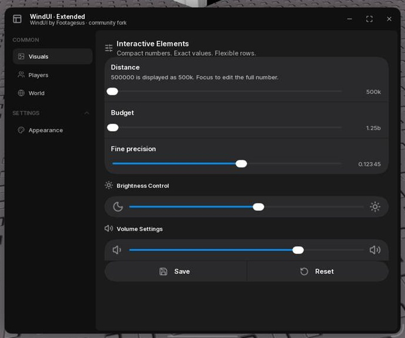
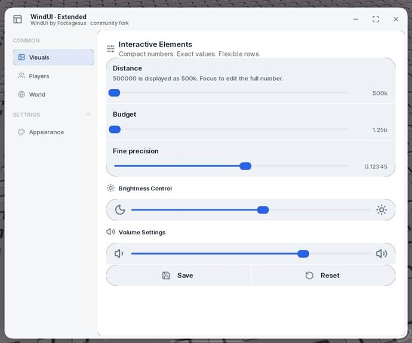
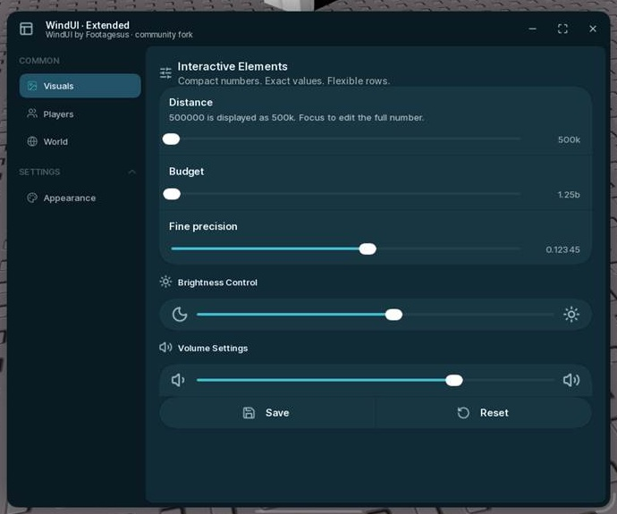
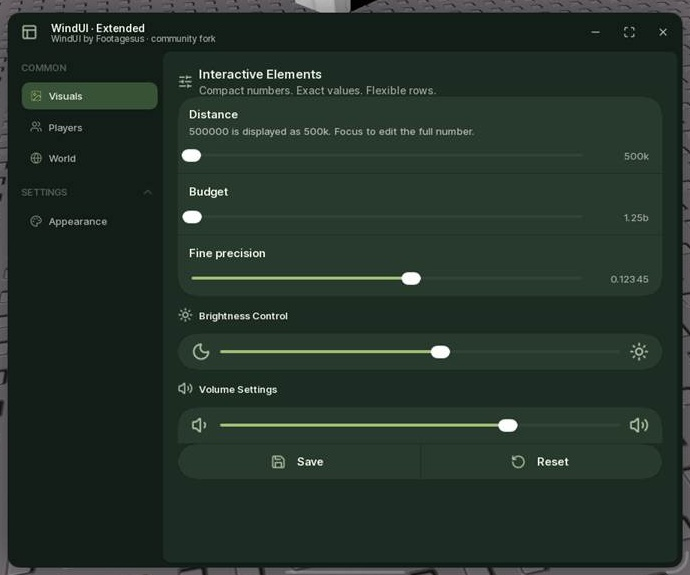
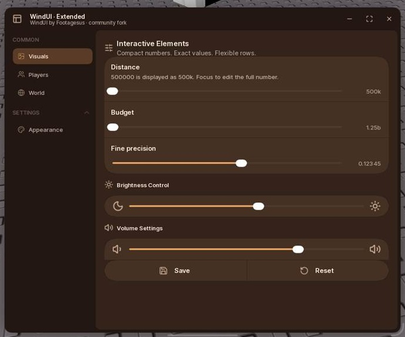
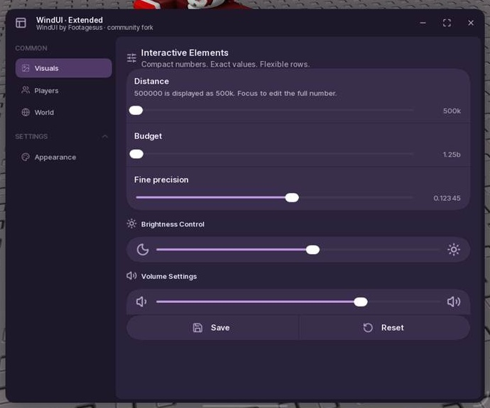
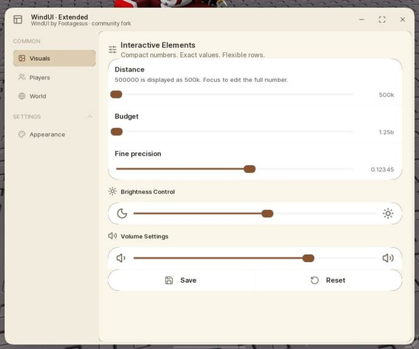

# WindUI Extended

Community fork of [WindUI by Footagesus](https://github.com/Footagesus/WindUI), based on upstream `d2c9bac5f96f997418d680d19cb759892542e492` (1.6.66). Original MIT license and copyright retained unchanged. This fork is not an official Footagesus release.

## Run the complete example

```lua
loadstring(game:HttpGet("https://raw.githubusercontent.com/123ads213/WindUI/main/ForkExample.lua"))()
```

Or load just the library:

```lua
local WindUI = loadstring(game:HttpGet("https://raw.githubusercontent.com/123ads213/WindUI/main/dist/main.lua"))()
```

Use `ForkExample.lua`, not the upstream `Example.lua` / `main.client.lua` launchers, which intentionally remain upstream examples and may load the upstream URL. The showcase's Save button is a notification demo, not an implemented settings-storage backend.

## Compact numbers

Sliders and ProgressBar Value/Fraction modes automatically show `500k`, `1.25m`, `1b`, `1t`, `qa`, `qi`, `sx`, `sp`, `oc`, `no`, `dc`. Values from 1e36 use scientific notation. This is display formatting only: callbacks, `:Get()` and config values remain numbers. Above 2^53, Roblox doubles do not represent every integer exactly.

- `Compact = false` opts out.
- `Decimals = 2` controls compact display, not the underlying slider value/step.
- Focus a slider's value field to edit the full number; `500k`, `1.25m`, plain values and scientific notation are accepted. Invalid text restores the prior value.
- `Format = function(value) return ... end` overrides slider display and its tooltip. ProgressBar retains its existing Format callback signature.
- `WindUI.NumberFormat.Format(number, options)` is available for custom counters/paragraphs. Arbitrary user-written text is not automatically converted.

## Slider layout and interaction

- NewElements sliders default to `Layout = "Stacked"`: title and description above a full-width control. It stretches with its parent.
- `Layout = "Inline"` retains a right-side control; `Width` controls that row's fixed width. Classic (`NewElements = false`) defaults to Inline.
- `ValueWidth = 80` is a stable value field. Long custom formats need a larger slot. The slot does not change with the number while dragging; editing scrolls within the field.
- Compact display is used both in the field and the floating tooltip.
- Drag updates are direct, not re-tweened every frame. Track mapping is captured at drag start. Drag connections and scroll lock are cleaned on release, locking and destruction.
- Added `:Get()` and `:SetRange(min,max)`. Invalid/non-finite values are ignored, reversed bounds normalized, equal bounds supported, and step results clamped.
- Fractional steps do not round numeric callbacks to two decimals.

## Sidebar groups

The first reference image is a sidebar heading with child tabs, rather than a horizontal second tab bar:

```lua
local Common = Window:Section({Title = "COMMON", Collapsible = false, Indent = 12})
local Visuals = Common:Tab({Title = "Visuals", Icon = "image"})
local Players = Common:Tab({Title = "Players", Icon = "users"})
```

`Collapsible` defaults to true, preserving upstream behavior. `Opened = true` opens a collapsible group initially. Static groups cannot be closed. Separate tab content pages are retained.

## Layout from the second reference

Upstream already supports `HStack` / `Group`, button `Icon`, `IconAlign`, `Justify`, section `Icon`, and `Slider.Icons = {From=..., To=...}`. The showcase combines them. This fork also corrects row gap accounting and remainder distribution so two buttons fill a row cleanly, including rows with fixed-width spacers.

## Themes

`Dark` is preserved byte-for-byte as a palette. `Light` is tuned for neutral surfaces and darker readable text. Curated alternatives: `Ocean`, `Forest`, `Ember`, `Orchid`, `Paper`. Non-Dark selected tab icons use their theme's Primary accent.

Other upstream theme keys were removed deliberately instead of keeping many near-duplicate presets. Update existing configurations referring to those names before switching to this fork. Existing custom themes added with `AddTheme` remain supported. No claim of a complete contrast/accessibility audit is made.

## Build and test

```sh
git clone --recurse-submodules https://github.com/123ads213/WindUI.git
cd WindUI
# Install Darklua and Luau CLI; npm dependencies are not needed for a release build.
npm test
npm run build
```

`tests/NumberFormat.luau` is an offline Luau regression suite. `tests/ForkRuntime.lua` runs after the showcase inside a Roblox executor and tests numeric state, focus/input signals, bounds, locking, fractional precision, synthetic touch-style dragging and multiple window sizes. It mutates and restores only showcase controls. Synthetic signal tests are not a substitute for a physical mouse/touch-device test.

The example explicitly sets MinSize 600x400 and MaxSize 1440x1100; upstream's default maximum is only 850x560. Library-wide window size defaults were not changed.

## Real Roblox screenshots

Captured from the MCP-connected Roblox client; cropped to the UI, not browser mockups.

### Dark



### Light



### Ocean



### Forest



### Ember



### Orchid



### Paper



