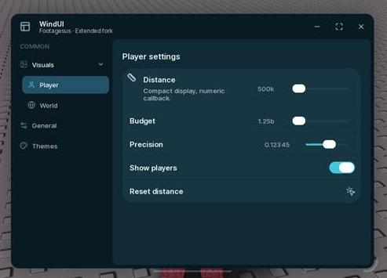

# Revision 2 QA — 2026-10-18

Revision 2 restores upstream inline controls and introduces actual parent-tab → child-tab pages. The rejected dashboard layout is not used.

## Verified offline

- NumberFormat: 20 display cases plus parsing, bounds and precision assertions passed.
- TabTree: 12 routing cases passed.
- Release build succeeds with Darklua 0.19.0 and the pinned upstream icons submodule.
- All 78 source/release/example/runtime-test Lua files compile with Luau.
- Element Section.lua, HStack.lua and Group.lua are byte-identical to upstream. Sidebar Section adds an optional HeaderSize; its original default stays 42.
- Original window min/max defaults (560×350 / 850×560) retained.

## Verified in Roblox through MCP

Client 00770cfb-0e7e-4b12-a2cc-b81c918995d5, Just a baseplate, viewport 2560×1440.

`tests/ForkRuntime.lua`: **59 assertions passed**:

- Real nested pages, parent resolves to first/remembered child, separate Player/World containers.
- Ordinary tabs unchanged, direct child selection opens ancestors, parent GUI-signal clicks collapse/expand.
- Expansion and collapse both have intermediate heights; rapid reversal finishes expanded without an old completion callback hiding it.
- LockOffscreen keeps rendered bounds inside all four corners at UIScale 0.75 and 1.0. Disabling permits offscreen placement; enabling rescues it.
- Compact fields, numeric callbacks, input parsing, invalid-input restoration, bounds, NaN, equal ranges and fractional precision.
- Stable drag track geometry at six positions; no digit-driven width changes.
- Long 283.78m text fits its fixed field, stays separated from a 100px track; requested 10px content inset.
- Original inline text/control separation at 560×350, 740×520 and 850×560.

These assertions use synthetic GUI signals and programmatic placement; they are not a physical device matrix. A topbar drag was separately verified with synthetic touch signals: dragging toward Y=-5000 stopped at Y=0 and released cleanly. A later VirtualInputManager attempt did not reliably begin a drag and is not counted as evidence. Actual OS screenshots were captured and visually inspected: original inline layout, nested child indentation and distinct Player/World content.

## Limits

No mobile/touch hardware matrix, extreme custom text-width stress test or viewport-resize device matrix. For an explicitly oversized window, resize/scale it to fit; position locking does not silently change your configured dimensions. No claim that unrelated upstream issues have all been eliminated.

## Revision 3 follow-up — decimal tails / stranded demo

- Reproduced the user's exact value live: the old field contained `-0.0232599999999999` while Step was 0.00001.
- Confirmed two separate WindUI roots: one current at Y=0, one stranded old example at Y=1184. This was not the current window crossing the top boundary.
- Added 2001 signed lattice checks plus negative-minimum/scientific-step regressions offline.
- Runtime regression suite: **65 assertions passed**, including clean negative display, focused edit text, numeric callback at -0.02326, and actual drag-handler start/top-boundary/release signals.
- Separate rerun suite: **7 assertions passed**. Three repeated starts, a controlled setup failure with recoverable handle, and concurrent invocations all settle to one demo root.
- The new cleanup removed the already stranded older example; one WindUI demo root remains.

All 79 source/release/example/runtime-test Lua files compile in this follow-up. `Precision-TopEdge.jpg` and `TopEdge-Full.jpg` are actual OS captures after the synthetic drag: clean -0.02326, one demo at the top client boundary. The native Roblox title bar visible above the client area is outside WindUI's viewport.

## Revision 4 correction — GUI origin and light borders

The earlier boundary assertions assumed origin (0,0). That was insufficient: live ScreenGui.AbsolutePosition was (0,-58), while AbsoluteSize and camera viewport were 2560×1440. This explains the user's 58px upper gap / lower overflow. Current tests compare against the actual ScreenGui rectangle, including its origin, and listen for origin changes.

- Updated runtime suite: **65 assertions passed** with real-origin corner and drag checks.
- Separate visual/component suite: **51 assertions passed** across Light → Paper → Dark → Ocean → Light; native contours, unchanged layout-child counts and row heights, preserved joined row corners, clean thumb on/off states, exact relative top/bottom edges.
- A discarded CanvasGroup prototype added layout items; it was removed before publication. Final rendering uses only UICorner/UIStroke components, not extra frames or compositing groups.
- Native OS chrome is outside the scope of ScreenGui rendering. Test results do not claim to draw over the native Roblox title bar.

Final actual captures: `Light-Clean.jpg`, `Viewport-Top.jpg`, `Viewport-Bottom.jpg`. Measured top at -58 relative GUI coordinates (top gap 0); bottom at Y=862 for a 520px-high window (bottom gap 0). Camera viewport 2560×1440. Final compilation check covers 82 Lua files.

## Revision 5 — page selection, coloured-theme contours, title icon

- No edits to `window/Init.lua` sizing, scaling or resize handling in this revision. `SetSize` and `Window:SetUIScale` function bodies also compared byte-for-byte against upstream d2c9bac5 and match. Example remains 740×520; upstream limits 560×350–850×560.
- Ocean/Forest/Ember/Orchid now opt in to the already tested clean renderer; Light/Paper/Dark settings and all palettes unchanged.
- Upstream page-anchor slide retained; changed timing to 0.24 seconds Quad Out to match child expansion. Active-page reselect is a no-op; old page tween cancelled on a new selection.
- `General → Tab selection` demonstrates original `Window:SelectTab(index)` API.
- Slider forwards `Icon`/`Image` plus size to the existing element-image slot. Example Distance has an 18px ruler. This is not a new global layout.
- Local NumberFormat, 2001 signed decimal lattice cases and TabTree tests passed; 82 Lua files compiled before adding the new selection test (which was executed successfully on client).
- Live client runtime regression: **65 checks passed**, including original window limits, GUI-origin bounds, synthetic slider signals and compact values.
- Live visual regression: **86 checks passed**, cycling Light, Paper, Dark, Ocean, Forest, Ember, Orchid and Light; confirms stable row heights/child counts, joined corners, native theme colours/alpha and toggle edges.
- New live selection/icon regression: **9 checks passed**: intermediate page anchor, settled anchor, no reselect restart, rapid-selection latest page, example dropdown selects Player, visible 18px title icon, icon/title/control non-overlap.
- These are synthetic API/GUI-signal checks, not a physical mouse/device compatibility matrix. Actual OS-window Ocean screenshot inspected for native contours and title icon.

